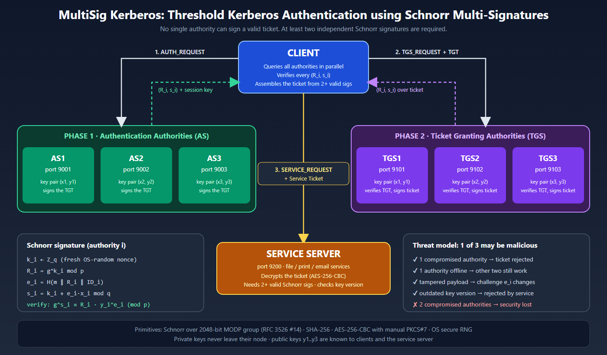

## MultiSig Kerberos: Threshold Kerberos Authentication using Schnorr Multi-Signatures

Kerberos is a login system that uses tickets to prove who you are. In the normal version, one central server hands out those tickets, so if an attacker breaks into that one server, they can create tickets for anyone.

This project removes that weakness. The ticket-issuing job is shared between **three independent servers**, each with its own secret key. A ticket is accepted only when **at least two of the three servers have signed it**. If an attacker takes over one server, they still cannot forge a valid ticket, and if one server goes down, the other two keep the system running.



## Table of Contents

1. [Introduction](#introduction)
2. [Demo](#demo)
3. [Architecture](#architecture)
4. [File Structure](#file-structure)
5. [Getting Started](#getting-started)
6. [Build, Test and Run](#build-test-and-run)
7. [How the Cryptography Works](#how-the-cryptography-works)
8. [Usage](#usage)
9. [Experiments and Results](#experiments-and-results)
10. [Troubleshooting](#troubleshooting)
11. [References](#references)

---

## Introduction

### The problem

Kerberos is a way for a user to prove who they are to a network service without sending their password around. It works with tickets. A central server, the **Authentication Server (AS)**, gives the user a first ticket called a TGT. A second server, the **Ticket Granting Server (TGS)**, trades that TGT for a ticket to a specific service, such as a file server.

In normal Kerberos each of those servers is a single machine that everybody has to trust. If an attacker takes over just one of them, they can create valid tickets for anyone, including administrators. One break is enough to lose everything.

### The idea

This project splits each of those servers into **three independent servers**:

- AS1, AS2 and AS3 take the place of the AS.
- TGS1, TGS2 and TGS3 take the place of the TGS.

Every server has its own secret signing key and never shares it. When a server issues a ticket, it signs it with its own key. A ticket is accepted only if it carries **valid signatures from at least two different servers**.

So an attacker who controls one server can make one valid signature, but never two. Their forged tickets get rejected. And if one server simply crashes, the other two can still issue tickets, so the system keeps working.

### What you get

| Situation | What happens |
|-----------|--------------|
| One server is hacked | It cannot issue a usable ticket by itself |
| One server goes offline | The other two still work |
| Someone edits a ticket | The signatures no longer match and the ticket is rejected |
| Someone replays an old signature | It does not match the new ticket and is rejected |
| Two servers are hacked | The scheme breaks. This is outside what it protects against (see [SECURITY.md](SECURITY.md)) |

The signature maths (Schnorr signatures, modular exponentiation, padding) is written from scratch in this project. The only thing taken from a library is the basic AES block cipher.

---

## Demo

This is real output from a run with all seven servers started on one machine.

**A user logging in and reaching the file service**

```text
$ python3 client.py --client ishaan --service file_service

[Phase 1] Requesting TGT from AS cluster ...
  [Phase1] TGT assembled with 3 valid AS signatures ✓
  Phase 1 completed in 66.5 ms

[Phase 2] Requesting Service Ticket from TGS cluster ...
  [Phase2] Service Ticket assembled with 3 valid TGS signatures ✓
  Phase 2 completed in 97.7 ms

[Phase 3] Presenting Service Ticket to Service Server ...
  [Phase3] Service access GRANTED ✓
  Phase 3 completed in 80.5 ms

  SERVICE RESPONSE:
  Welcome to the File Service. Here are your files: [doc1.txt, doc2.pdf]

Total authentication time: 244.8 ms
```

**The six attacks, all stopped**

```text
$ python3 attacks.py --no-servers

  Attack 1: Single malicious authority issuing forged ticket   DEFENDED
  Attack 2: Modified ticket payload (tampering)                DEFENDED
  Attack 3: Replay of old partial signature                    DEFENDED
  Attack 4: Leakage of one authority's private signing key     DEFENDED
  Attack 5: Authority offline scenario                         DEFENDED
  Attack 6: Ticket containing only one valid signature         DEFENDED

  All attack scenarios successfully defended!
```

---

## Architecture


The editable vector version is [docs/architecture-diagram.svg](docs/architecture-diagram.svg).

### The parts

| Part | What it does | Port |
|------|--------------|------|
| Client | The user's program. Talks to every server and checks every signature it gets back | n/a |
| AS1, AS2, AS3 | Check who the user is and each sign a TGT | 9001, 9002, 9003 |
| TGS1, TGS2, TGS3 | Check the TGT and each sign a service ticket | 9101, 9102, 9103 |
| Service server | Checks the service ticket and serves the user | 9200 |

### How a login works

There are three phases.

1. **Phase 1, get a TGT.** The client asks AS1, AS2 and AS3 for a ticket. Each one answers with its own signature. The client checks every signature, and once it holds at least two valid ones it builds the TGT.
2. **Phase 2, get a service ticket.** The client shows the TGT to TGS1, TGS2 and TGS3. Each one checks the TGT first, then signs a ticket for the requested service. Again the client keeps at least two valid signatures.
3. **Phase 3, use the service.** The client sends the service ticket to the service server. The server decrypts it, checks that at least two signatures are valid and that the key version is current, and then lets the user in.

```text
Client                    AS1 / AS2 / AS3        TGS1 / TGS2 / TGS3        Service
  |                              |                       |                    |
  |-- AUTH_REQUEST (all 3) ----->|                       |                    |
  |<-- (R_i, s_i) + session key -|                       |                    |
  |   check each signature, keep 2 or more, build TGT    |                    |
  |                                                      |                    |
  |-- TGS_REQUEST + TGT (all 3) ------------------------>|                    |
  |                              each TGS checks the TGT signatures           |
  |<-- (R_i, s_i) over service ticket -------------------|                    |
  |   check each signature, keep 2 or more, build ticket                      |
  |                                                                           |
  |-- SERVICE_REQUEST + Service Ticket ------------------------------------->|
  |                          decrypt, check 2 or more signatures and version  |
  |<-- Access granted -------------------------------------------------------|
```

### What is inside a ticket

Each ticket holds the client ID, service ID, issue time, lifetime, session key, key version and the authorities' signatures. The ticket is encrypted with AES-256-CBC.

<details>
<summary>Example TGT</summary>

```json
{
  "payload": {
    "client_id":   "ishaan",
    "tgs_id":      "TGS",
    "timestamp":   1710000000.0,
    "lifetime":    3600,
    "key_version": 1
  },
  "signatures": [
    { "R": "0x...", "s": "0x...", "authority_id": "AS1", "public_key": "0x..." },
    { "R": "0x...", "s": "0x...", "authority_id": "AS2", "public_key": "0x..." }
  ],
  "tgt_session_key_enc": { "iv": "...", "ciphertext": "..." }
}
```
</details>

<details>
<summary>Example service ticket</summary>

```json
{
  "payload": {
    "client_id":   "ishaan",
    "service_id":  "file_service",
    "timestamp":   1710000001.0,
    "lifetime":    3600,
    "key_version": 1
  },
  "signatures": [
    { "R": "0x...", "s": "0x...", "authority_id": "TGS1", "public_key": "0x..." },
    { "R": "0x...", "s": "0x...", "authority_id": "TGS2", "public_key": "0x..." }
  ],
  "iv":         "...",
  "ciphertext": "..."
}
```
</details>

---

## File Structure

```text
MultiSig-Kerberos/
├── crypto_utils.py       # Schnorr signatures, modular exponentiation, AES-256-CBC, PKCS#7
├── master_keygen.py      # Creates the key pair for every authority
├── as_node.py            # Authentication server (run as AS1, AS2 or AS3)
├── tgs_node.py           # Ticket granting server (run as TGS1, TGS2 or TGS3)
├── service_server.py     # The service that checks tickets
├── client.py             # The user's program, runs all three phases
├── attacks.py            # Demonstrates six attacks and how they fail
├── README.md             # This file
├── SECURITY.md           # Detailed security analysis
├── docs/
│   ├── architecture-diagram.png  # Diagram used in this README
│   └── architecture-diagram.svg  # Same diagram as an editable vector file
└── keys/                 # Created by master_keygen.py
    ├── AS1.json   AS2.json   AS3.json
    ├── TGS1.json  TGS2.json  TGS3.json
    └── system_params.json
```

---

## Getting Started

This guide is for **Ubuntu or Debian Linux**. You need Python 3.8 or newer.

### Quick start (5 commands)

```bash
sudo apt update && sudo apt install -y python3 python3-pip   # 1. Python
pip3 install cryptography                                     # 2. AES library
python3 master_keygen.py                                      # 3. create the keys
# 4. start the 7 servers (see below), then log in:
python3 client.py --client ishaan --service file_service      # 5. run a login
```

### Start the servers

All seven servers must be running. This starts them in the background:

```bash
for a in AS1 AS2 AS3;    do python3 as_node.py  $a & done
for t in TGS1 TGS2 TGS3; do python3 tgs_node.py $t & done
python3 service_server.py &
```

Stop them all with:

```bash
kill $(jobs -p)
```

The `cryptography` package is used only for the raw AES block cipher. If you prefer, `pycryptodome` also works.

---

## Build, Test and Run

Nothing needs to be compiled. Run these in order:

| Step | Command | What it does |
|------|---------|--------------|
| 1 | `python3 crypto_utils.py` | Self-test of the signature and encryption code |
| 2 | `python3 master_keygen.py` | Creates the `keys/` folder (add `--force` to replace old keys) |
| 3 | `python3 as_node.py AS1` (then `AS2`, `AS3`) | Starts the authentication servers |
| 4 | `python3 tgs_node.py TGS1` (then `TGS2`, `TGS3`) | Starts the ticket granting servers |
| 5 | `python3 service_server.py` | Starts the service server |
| 6 | `python3 client.py` | Runs a full login |
| 7 | `python3 attacks.py` | Runs all the attack demos |

If the self-test works, you will see:

```text
Schnorr sign+verify: PASS
Reject tampered msg: PASS
Multi-sig (2-of-2) valid: PASS
Reject single sig:        PASS
AES-256-CBC round-trip:   PASS
PKCS#7 padding:           PASS
=== All tests passed ===
```

---

## How the Cryptography Works

Every authority $i$ has a **private key** $x_i \in \mathbb{Z}_q$ that it keeps secret and a **public key** that everyone knows:

$$y_i = g^{x_i} \bmod p$$

A signature proves that the owner of the private key approved a message, without revealing the key.

**Signing.** To sign a message $m$, authority $i$ does the following:

| Step | Formula | Meaning |
|------|---------|---------|
| 1. Nonce | $k_i \xleftarrow{\$} \mathbb{Z}_q$ | A fresh random number for every signature |
| 2. Commitment | $R_i = g^{k_i} \bmod p$ | Hides the nonce |
| 3. Challenge | $e_i = H(m \parallel R_i \parallel ID_i) \bmod q$ | SHA-256 fingerprint of the message, the commitment and the signer |
| 4. Response | $s_i = k_i + e_i \cdot x_i \bmod q$ | Mixes the nonce with the private key |

The signature is the pair $(R_i, s_i)$.

**Verifying.** Anyone can check the signature using only the public key $y_i$. They recompute $e_i$ and test:

$$g^{s_i} \equiv R_i \cdot y_i^{\,e_i} \pmod p$$

This holds for an honest signature because

$$g^{s_i} = g^{k_i + e_i x_i} = g^{k_i} \cdot \left(g^{x_i}\right)^{e_i} = R_i \cdot y_i^{\,e_i}$$

If even one bit of the message changes, $e_i$ changes and the check fails.

**The two-signature rule.** A ticket is valid only if at least two signatures from **different** authorities pass this check. One authority cannot count twice. A ticket signed with an old key version is rejected as well.

| Setting | Value |
|---------|-------|
| Group | 2048-bit safe prime from RFC 3526 (MODP Group 14) |
| Subgroup order $q$ | 256-bit prime |
| Hash | SHA-256 |
| Ticket encryption | AES-256-CBC with hand-written PKCS#7 padding and a random 16-byte IV |
| Randomness | The operating system's secure random source |

A new random $k_i$ is used for every signature. If the same nonce signed two different messages, an attacker could subtract the two responses and solve for the private key:

$$x_i = \frac{s_i - s_i'}{e_i - e_i'} \bmod q$$

That is why a nonce is never reused.

---

## Usage

### Run a login

```bash
python3 client.py --client ishaan --service file_service --verbose
```

| Option | Default | Meaning |
|--------|---------|---------|
| `--client` | `ishaan` | Who is logging in: `ishaan`, `ankit` or `vipin` |
| `--service` | `file_service` | Which service: `file_service`, `print_service` or `email_service` |
| `--password` | automatic | Password for the user (set in `as_node.py`) |
| `--host` | `127.0.0.1` | Machine where the servers run |
| `--verbose` | off | Show the signature details for each step |

### Generate or replace keys

```bash
python3 master_keygen.py            # create keys if they do not exist
python3 master_keygen.py --force    # replace keys, all old tickets stop working
```

### Run the attack demos

```bash
python3 attacks.py                  # all six attacks
python3 attacks.py --scenario 3     # only attack number 3
python3 attacks.py --no-servers     # use servers you already started
```

If no servers are running, `attacks.py` starts its own.

### Ports used

| Server | Port | Server | Port |
|--------|------|--------|------|
| AS1 | 9001 | TGS1 | 9101 |
| AS2 | 9002 | TGS2 | 9102 |
| AS3 | 9003 | TGS3 | 9103 |
| Service | 9200 | | |

---

## Experiments and Results

### The six attacks

| # | Attack | Result | Why it fails |
|---|--------|--------|--------------|
| 1 | One malicious server forges a ticket | Defended | The forged second signature does not match the other server's public key |
| 2 | Someone edits the ticket (for example changes the user to `admin`) | Defended | The edit changes the hash, so every signature stops verifying |
| 3 | An old signature is replayed on a new ticket | Defended | The old signature belongs to the old ticket contents |
| 4 | One server's private key leaks | Defended | The attacker still cannot produce the second signature |
| 5 | A server goes offline | Defended | Two servers still work, one alone is refused |
| 6 | A ticket with only one valid signature | Defended | One signature is below the required two |

The full reasoning, including why two compromised servers would break the system, is in [SECURITY.md](SECURITY.md).

### Speed

These numbers come from one run on my own machine with all servers on localhost. Primitive timings are the average of 30 runs. Your numbers will differ.

| Operation | Time |
|-----------|------|
| Create a key pair | 2.9 ms |
| Sign once | 2.9 ms |
| Verify once | 9.0 ms |
| Phase 1 (three authorities) | 66.5 ms |
| Phase 2 (three authorities) | 97.7 ms |
| Phase 3 (service) | 80.5 ms |
| **Whole login** | **244.8 ms** |

Checking a signature costs about three times as much as making one, because it needs two big exponentiations instead of one. Asking three servers instead of one makes every login a little slower, and that small cost is what removes the single point of failure.

---

## Troubleshooting

| Problem | Cause | Fix |
|---------|-------|-----|
| `Neither 'cryptography' nor 'pycryptodome' is installed` | The AES library is missing | `pip3 install cryptography` |
| `FileNotFoundError` mentioning `system_params.json` | Keys were not created | `python3 master_keygen.py` |
| `Address already in use` | An old server is still running | `pkill -f _node.py; pkill -f service_server.py` |
| `Connection refused` | The servers are not started | Start all seven servers first |
| Tickets rejected after running `master_keygen.py --force` | The keys changed, so old tickets are outdated | Restart the servers and log in again |
| Login fails for a user | Wrong user name or password | Use `ishaan`, `ankit` or `vipin`, or edit `USER_REGISTRY` in `as_node.py` |

---

## References

1. C. P. Schnorr, "Efficient Signature Generation by Smart Cards", *Journal of Cryptology*, 1991.
2. J. Steiner, C. Neuman, J. Schiller, "Kerberos: An Authentication Service for Open Network Systems", USENIX Winter Conference, 1988.
3. C. Neuman et al., RFC 4120, *The Kerberos Network Authentication Service (V5)*.
4. T. Kivinen, M. Kojo, RFC 3526, *More Modular Exponential (MODP) Diffie-Hellman groups for IKE*.
5. NIST FIPS 180-4 (SHA-256) and FIPS 197 (AES).
6. [SECURITY.md](SECURITY.md) for the full threat analysis.
